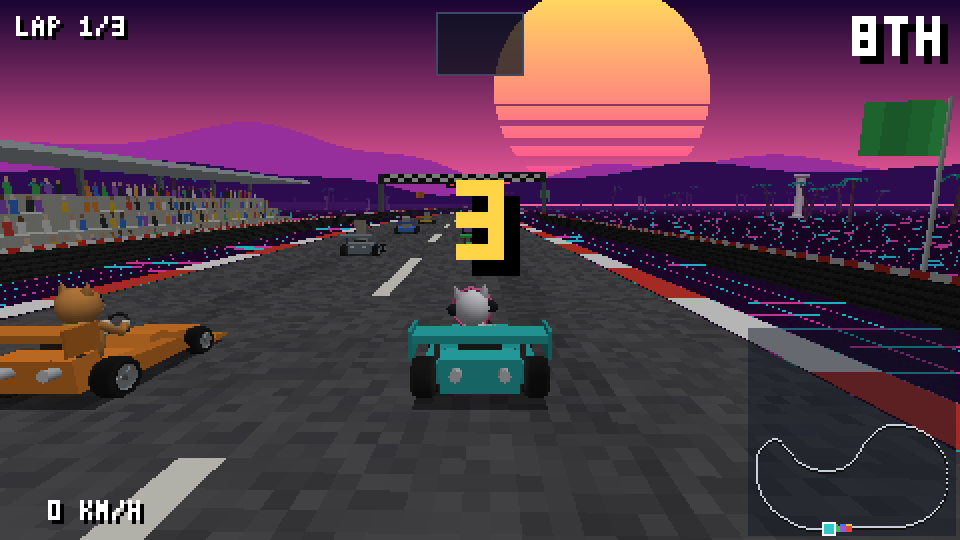
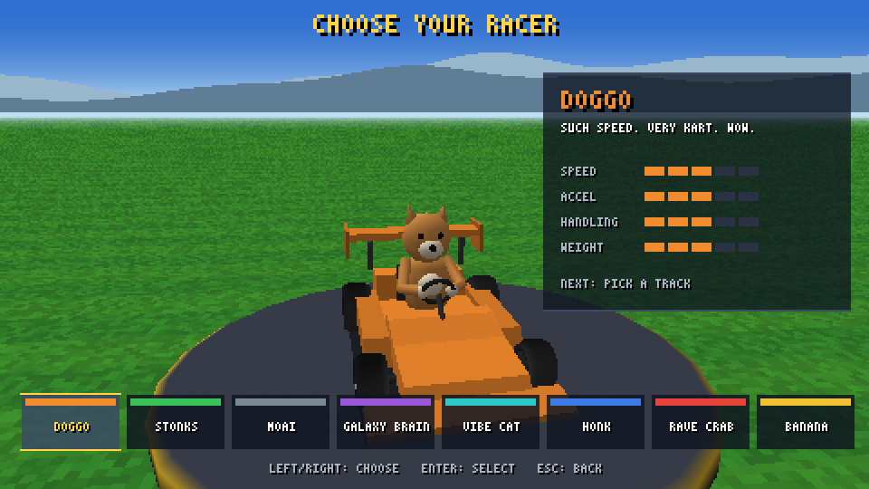
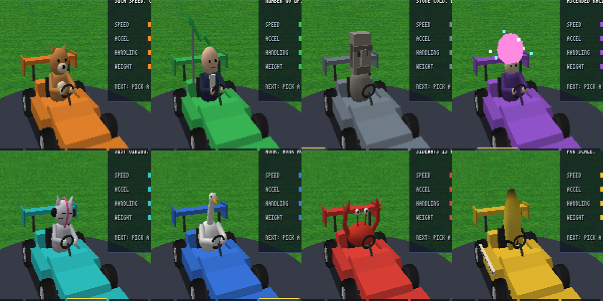
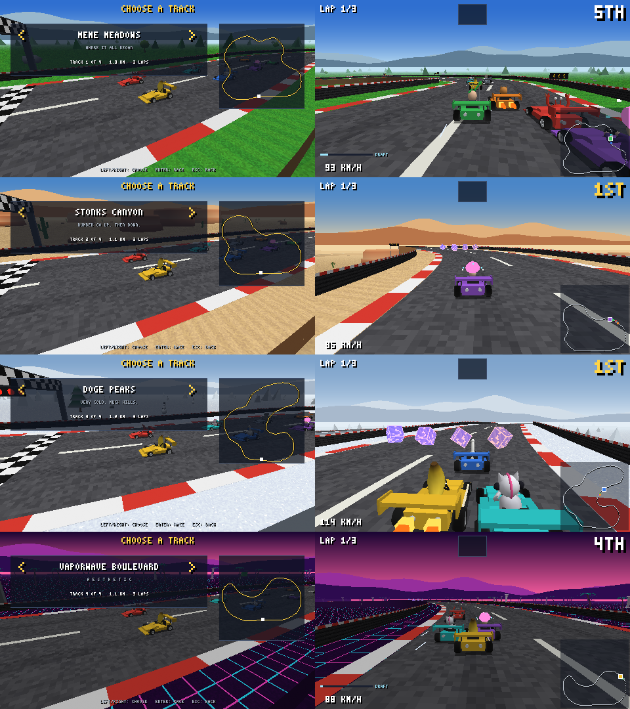

# Slipstream

A 3D kart racer written from scratch in C++20: no engine, no graphics API, no
third-party libraries. It has its own software rasterizer, a fixed-point
deterministic simulation, rollback netcode over UDP, rebindable keyboard and
controller input, and Mario Kart–style items.






## Features

- **8 meme-inspired racers**, all original designs built from code. They riff on meme *ideas*
  rather than copying anyone's character or likeness:

  | Racer | Bit | Strength |
  |---|---|---|
  | **Doggo** | a shiba ("such speed, very kart, wow") | balanced |
  | **Stonks** | a suit and a chart arrow that only goes up | top speed |
  | **Moai** | a stone head. That's it. | heavyweight |
  | **Galaxy Brain** | an enormous glowing brain | handling |
  | **Vibe Cat** | headphones on, head bobbing | acceleration |
  | **Honk** | a goose with wings on the wheel | aggressive all-rounder |
  | **Rave Crab** | claws up, bouncing | handling |
  | **Banana** | a banana, plus a ruler for scale | featherweight |

  Stats live in the deterministic simulation: top speed, acceleration, steering rate, and weight
  (heavier karts shove lighter ones in collisions). Bots take whichever characters the players
  didn't pick.
- **4 tracks**, each with its own layout, elevation profile and look:
  - **Meme Meadows**: green and rolling.
  - **Stonks Canyon**: desert with a 14 m climb and drop, cacti and mesas.
  - **Doge Peaks**: snowy and twisty, with snowy pines and snowmen.
  - **Vaporwave Boulevard**: a neon grid at night under a sliced synthwave sun, with palms and
    marble columns.
- **Character and track select screens.** The character screen shows your racer turning on a podium
  with stat bars. The track screen runs the chosen track live behind the menu, with its map.
- **8-kart races** against AI drivers, 3 laps.
- **Drift mini-turbos** in three tiers. Hold drift through a bend and the sparks go blue, then
  orange, then purple. Releasing gives a boost that gets longer with each tier. A HUD meter shows the
  charge and the tier reached.
- **Slipstream.** Tuck in 3–12 m directly behind another kart. After about 1.7 seconds in its wake
  you get a speed boost ("SLIPSTREAM!"), and wind streaks and a DRAFT meter show the charge
  building. The two most skilled bots actively hunt for drafts on straights.
- **Items** from item boxes, rolled by race position (leaders get defensive items, the back
  of the pack gets catch-up items):
  **Boost**, **Banana** (dropped behind you), **Green Shell** (fires straight and bounces off
  walls), **Red Shell** (follows the road, then homes in on the kart ahead), and **Star**
  (invincible, faster, spins out anyone you touch).
  Hold *look back* when firing a shell to throw it backwards.
- **Online multiplayer** for up to 4 players, with bots filling the rest of the grid. Each player's
  character choice travels in the lobby messages, and the host picks the track.
- **Controls screen** where any action can be rebound on keyboard or controller (XInput). Bindings
  are saved to `slipstream_controls.cfg` in plain text, which you can also edit by hand.

## How it's built

### Rendering: `src/render/`
All 3D is drawn by the CPU into a 480x270 framebuffer. A platform only has to *present* pixels,
which makes porting much easier.

- Vertex transform, then trivial reject by outcodes, then homogeneous clipping (Sutherland–Hodgman,
  only for triangles that actually cross a plane), then back-face culling.
- Rasterization with integer edge functions and 4 bits of sub-pixel precision, and
  perspective-correct UVs and vertex colours.
- 1/w depth buffer, linear fog, procedural textures, blob shadows.
- Front-to-back drawing of track chunks plus sphere-vs-frustum culling.
- A typical race frame submits about 12,000 triangles (about 5,000 survive culling) and renders
  in **~2.8 ms** (x64 Release, single-threaded) against a 16.7 ms budget.

### Models: `src/render/modeling.cpp`
There are no model files. Every model is generated at startup by a small procedural modelling kit:

- **Lathe** spins a 2D profile around an axis. Repeating a profile point makes a hard crease, and
  optional radius jitter roughens surfaces.
- **Extrude** pushes a 2D outline across an axis. Concave outlines are capped by ear clipping.
- **Sweep** makes a tube along a path, with per-ring radius and colour. Its frame is
  parallel-transported so the tube never twists.
- **Torus**, **Box**, **Cone**, and quads that orient themselves to face a given direction.

Lighting (sun plus sky fill) is baked into vertex colours from smooth or faceted normals.

What gets built from it:

- **The kart**: an extruded monocoque with a cockpit cut-out, side pods and front and rear wings.
  The driver has a lathed torso, swept arms and a lathed helmet with a visor, holding a torus
  steering wheel. The lathed wheels have dished rims and five spokes, and they spin with speed,
  steer with turning, and counter-steer while drifting. There are swept exhausts and axles too.
  Beyond 30 m a low-detail stand-in is used instead.
- **Items**: shells (a lathed dome with a torus rim), bananas (a tapered sweep with brown tips), and
  glowing item boxes.
- **Scenery**: 3 pine and 2 broadleaf tree variants, 2 rocks, tyre stacks, chevron boards on the
  outside of bends, team-coloured flags along the straights, a grandstand with a seated crowd and a
  roof, and a start gantry whose lights follow the countdown. Trees have distant low-detail versions.

The 8 drivers are built the same way: a lathed shiba head with cone ears, a swept goose neck, a
jittered glowing brain, a banana swept along a curve, and so on. Each theme also gets its own
scenery set (cacti, mesas, snowmen, palms, columns) and ground texture.

`slipstream --gallery` opens a model viewer with every generated model lined up.

### Simulation: `src/game/`
- 16.16 fixed-point maths only. Sine comes from a baked integer table, and `atan2` is integer
  CORDIC. The square root uses the FPU only as an estimate, then corrects it with integer math to
  get an exact result.
- `SimState` is a flat struct with no pointers and no padding (enforced with
  `static_assert(has_unique_object_representations)`). That means a snapshot is a `memcpy` and a
  checksum is a hash of its bytes.
- The AI is a pure function of the state, so bots run identically on every peer and never cross
  the network.
- A full 8-AI race produces the **same final hash in x64 Release, x64 Debug and x86 Release**.

### Netcode: `src/net/`
- **Rollback** (`rollback.cpp`): remote inputs that haven't arrived yet are predicted. When the real
  input differs, the game restores the snapshot from that tick and resimulates to the present.
  Local inputs are scheduled 2 ticks ahead, which hides small latencies without rolling back at all.
  Prediction is capped at 10 ticks, beyond which the game waits rather than guessing further.
- **Session** (`session.cpp`): a UDP lobby, with the host relaying inputs between clients. Each packet
  carries every input the receiver hasn't acknowledged yet, so packet loss needs no
  retransmission timers. It also measures RTT, keeps clocks in sync (whoever is ahead skips ticks),
  and uses an explicit little-endian wire format with bounds-checked parsing.
- **Desync detection**: peers exchange hashes of fully confirmed states every second.
- **Network simulator**: `--lag`, `--jitter` and `--loss` degrade outgoing packets so rollback can be
  watched and tested on one machine.

### Portability: `src/platform/platform.h`
The game never includes an OS header. The platform layer covers present, input, timing, memory,
files and UDP sockets.

- `platform_win32.cpp` uses GDI, XInput (loaded at runtime) and Winsock.
- `platform_posix.cpp` is a headless backend for the test tools on Linux and macOS.
- Key codes are platform-neutral, so a bindings file works on any platform.
- Memory is one block reserved at startup and split into arenas: persistent, scratch, and a *level*
  arena that holds the current track's scene and is reset when you switch tracks. After init, `operator new` is
  counted, and any allocation during gameplay shows up red in the F1 overlay. The count is 0.

## Build and run (Windows, Visual Studio 2022)

```bat
build.bat                 :: x64 release -> build\x64-release\slipstream.exe
build.bat debug x64
build.bat release x86
```

A `CMakeLists.txt` with the tests below registered for `ctest` is included too, but it is untested:
CMake isn't installed on the development machine, so `build.bat` is the verified path.

### Controls (defaults, rebindable in-game)

| Action | Keyboard | Controller |
|---|---|---|
| Accelerate | W | A |
| Brake / reverse | S | B |
| Steer | A / D | Left stick |
| Drift (hold while steering; release for a mini-turbo) | Space | RB |
| Use item | E | LB |
| Look back | Q | X |
| Pause / menu | Esc | Start |

F1 toggles the debug overlay: frame timings, triangle counts, rollback stats, RTT, checksums and the
heap counter.

### Play online

Start one copy as the host. Each other player joins with the host's IP address. The host presses
Enter to start the race, and bots fill the empty grid slots.

```bat
slipstream --host --name ALEX
slipstream --join 192.168.1.20:7777 --name SAM
```

To try it on one machine, run both commands with `127.0.0.1:7777`. Add `--lag 80 --jitter 20 --loss 5`
to either to feel rollback at work. `--autopilot` lets the AI drive, and `--host --autostart 2`
starts as soon as 2 players are connected. Over a LAN, Windows Firewall asks once whether to
allow the game; same-machine play works either way.

## Tests and tools

| Command | What it proves |
|---|---|
| `slipstream --selftest` | Exact sqrt, the sine table, the CORDIC inverse, track baking, **a full 8-bot race finishing on every track**, sim determinism, `memcpy` snapshot/resume, slipstream (the follower boosts, the leader doesn't), mini-turbo tier lengths, spin-outs recovering facing forward, **two rollback peers with 6-tick-late inputs converging to ground truth**, and the bindings file round-trip |
| `slipstream --nettest 3600 --lag 80 --jitter 30 --loss 10 [--track N]` | A host and a client over **real UDP sockets** with simulated lag and 10% loss. Checks that the track and characters survive the handshake, then that both peers end bit-identical to each other *and* to an offline replay of the same inputs |
| `slipstream --nettest --desync-at 1000` | Corrupts one peer's memory and checks that the checksum exchange catches it at the next checkpoint |
| `slipstream --botrace [seed] [--track N]` | A full 8-AI race with lap times, off-road %, spin-outs, items, slipstream boosts, mini-turbos by tier, sim cost and the final hash |
| `slipstream --bench 1200 --shot out.bmp` | Runs the real app headless with the AI driving: frame time percentiles, triangle counts, arena usage, heap allocations, and a screenshot. Use `--screen characters`, `--screen tracks` or `--screen gallery` for menu and model shots, `--showcase 100` for a close orbit around your kart, and `--track N` / `--character N` to choose |

Measured on the development machine (x64 Release):

```
--nettest 5400 --lag 80 --jitter 30 --loss 10
  host    2743 rollbacks, max depth 9, 85 checksums matched
  client  2840 rollbacks, max depth 9, 74 checksums matched
  CONVERGED: both peers match each other and the offline ground truth

--bench 1500
  frame avg 2.75ms  p99 3.31ms  max 3.56ms   heap allocations during frames: 0

--botrace (3 seeds)
  ~2% off-road, 20 spin-outs and ~30 items per race, winners finish in ~2:03
```

## Layout

```
src/core      base.h (types, fixed point, trig table, CORDIC, hashing), memory (arenas, heap tripwire)
src/platform  platform.h (the porting surface), win32 and posix backends
src/render    math3d, raster (the rasterizer), modeling (procedural modelling kit), draw2d (HUD/font),
              scene (model/texture generation, prop placement, world drawing)
src/game      sim.h/.cpp (karts, items, AI, race rules), track.cpp (the 4 circuits, spline baking, track queries),
              characters.h (roster and stats), tracks.h (track catalogue and themes)
src/net       rollback (prediction + resimulation), session (UDP lobby, relay, sync, checksums)
src/app       app (screens, camera, HUD), input (actions, bindings, config file)
src/main.cpp  entry point and the headless test tools
```

## Known limits

- Only Windows has a windowed backend. The POSIX backend is headless and hasn't been compiled on
  Linux yet.
- No audio.
- Online play is lobby-based with direct IP. There's no NAT traversal, and if a player disconnects
  the race ends rather than replacing them with a bot.
- Rendering is single-threaded. Splitting the framebuffer into tiles across cores would be the next
  performance step.
